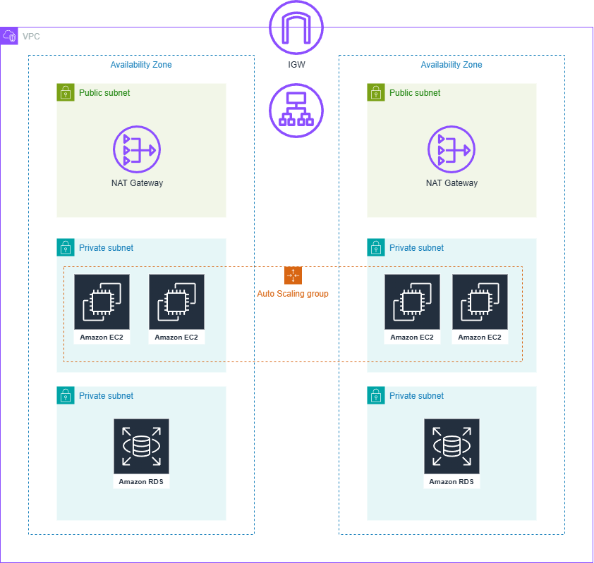

# 🏛️ Multi-AZ Fault-Tolerant 3-Tier Web Architecture on AWS

> A production-ready systems engineering project demonstrating high availability, stateless compute scaling, and secure network segmentation using an Application Load Balancer, Auto Scaling Groups, Golden AMI pre-baking, and an isolated relational database tier across multiple Availability Zones.

---

## Architecture Overview

The infrastructure is provisioned inside a Custom Virtual Private Cloud (VPC) engineered for fault tolerance and strict security boundaries:

- **Public Subnets:** House the **Application Load Balancer (ALB)** and **NAT Gateways** to securely manage ingress traffic and outbound patching routes.
- **Private Subnets (Compute Tier):** Host stateless application instances running inside an **Auto Scaling Group (ASG)** distributed across two Availability Zones (`us-east-1a` & `us-east-1b`).
- **Private Subnets (Database Tier):** Isolated **Amazon RDS MySQL** instance enforcing secure backend communication and persistent state storage.



---

## 🎥 Demo & Walkthrough

Watch the complete video demonstration of the infrastructure deployment, showcasing the multi-AZ Auto Scaling Group, ALB traffic distribution, live database connectivity, and backend health validation:

👉 **[Watch Live Architecture Walkthrough](https://drive.google.com/file/d/1s8YEDLMgWqZBrsyJTAKoHuzXpmoYYZPs/view?usp=drive_link)**

---

## Tech Stack & Components

- **Runtime & Framework:** Node.js, Express.js, PM2 (Process Manager)
- **Data Tier:** Amazon RDS MySQL
- **Cloud & Networking (AWS):** VPC, EC2, ALB, Target Groups, Auto Scaling Groups, Security Groups, IAM
- **Deployment Strategy:** Custom "Golden AMI" image baking to eliminate `cloud-init` boot bottlenecks and optimize cluster scale-out performance.

---

## Key Features & Engineering Highlights

1. **High Availability & Fault Tolerance:** Multi-AZ distribution ensures automated traffic shifting and zero single points of failure at the compute layer.
2. **Optimized Boot Performance (Golden AMI):** Pre-baked system dependencies and runtime configurations directly onto the machine image, drastically reducing instance initialization times during scaling events.
3. **Process Management & Reliability:** Utilizes **PM2** bound via `systemd` to guarantee autonomous application recovery and process persistence across reboots.
4. **Strict Security Segmentation:** Compute instances reside in private subnets, accepting ingress exclusively on port 5000 originating from the ALB Security Group, with database credentials protected via environment variables.

---

## ⚙️ Local Setup & Installation

1. **Clone the repository:**
   ```bash
   git clone [https://github.com/your-username/multi-az-fault-tolerant-3tier-architecture.git](https://github.com/your-username/multi-az-fault-tolerant-3tier-architecture.git)
   cd multi-az-fault-tolerant-3tier-architecture
2. **Optimized Boot Performance (Golden AMI):** Pre-baked dependencies and system configurations onto a custom image to minimize cloud-init bottlenecks and speed up ASG scaling events.
3. **Process Management:** Utilizes **PM2** configured with `systemd` to guarantee application persistence across reboots.
4. **Security Best Practices:** EC2 instances reside in private subnets, accepting traffic exclusively on port 5000 from the ALB Security Group, while database credentials are securely managed via environment variables.

---

## ⚙️ Local Setup & Installation

1. **Clone the repository:**
   ```bash
   git clone [https://github.com/your-username/devpulse.git](https://github.com/your-username/devpulse.git)
   cd devpulse
   ```
2. **Install dependencies:**
   ```bash
    npm install
   ```
1. **Configure environment variables**

   ##### Create a .env file in the root directory
   ```bash
    PORT=5000
    DB_HOST=your-rds-endpoint.amazonaws.com
    DB_USER=your_db_user
    DB_PASSWORD=your_db_password
    DB_NAME=devpulse
   ```

